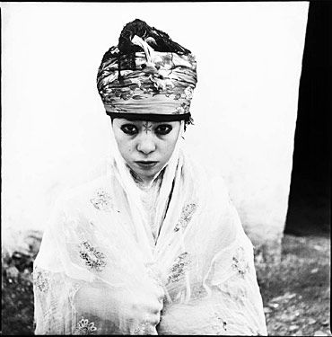

**Résumé**

**En 1960, pour les besoins de l’administration coloniale, Marc Garanger photographie des femmes algériennes, les contraignant à se dévoiler. En déterminant le contexte socioculturel et historique de ces photos prises pendant la guerre de Libération, la question du statut des femmes est posée. Mais la question du statut des femmes n’a été rendue visible qu’une fois la violence coloniale rendue elle-même visible. En effet, l’acte photographique viole les principes établis par la pratique locale relatifs à l’identité collective et à la non-mixité de l’espace féminin et masculin. Cette transgression des pratiques culturelles par les colons met en cause la structure de l’honneur, honneur basé sur la domination masculine et la soumission des femmes. À l’aliénation exercée par les hommes s’ajoute celle du pouvoir colonialiste.** 

**Cet article se propose de mettre en lumière le contexte socio-culturel et historique de photographies d’Algériennes prises par Marc Garanger pendant la guerre de Libération afin de déterminer les conditions de leur production. Mais n’entrent pas dans l’analyse les signes plastiques que sont le cadre, la lumière, le grain de la photographie, la composition, la profondeur de champ… Les dimensions esthétique et sensible ont été largement et inégalement abordées dans le champ de la critique d’art.**

**MARC GARANGER, PHOTOGRAPHE APPELÉ EN ALGÉRIE**

 En 1960, l’armée française délivre des cartes d’identité aux autochtones d’Algérie afin de contrôler leurs déplacements. Marc Garanger, appelé, est chargé de photographier les villageois de Aïn Terzine, Bordj Okriss, Mesdour, Meghnine, Souk el Khémis, situés au sud de la Grande Kabylie. Ces séances contraignent les femmes à se dévoiler. Pendant la colonisation, ces photos sont réservées à un usage strictement administratif. Mais après la guerre, certaines d’entre elles feront l’objet en 1982 notamment, d’une publication dans un recueil intitulé Femmes algériennes 1960 (Garanger, 1982), d’expositions et de divers articles publiés dans des revues photographiques. Á la fois photographies d’art et d’engagement, elles permettent de rendre visible la cruauté d’une guerre sans nom. Avec une grande lucidité, Marc Garanger s’est constitué au fil du temps son propre fonds documentaire, dans une guerre sans images, la censure française ayant rendu presque impossibles les représentations visuelles du conflit. C’est la distanciation réflexive, ce que Bourdieu appellera « l’objectivation participante » (Bourdieu, 2003 : 13) qui lui permettra de ne pas sombrer dans le désespoir face à cette violence insupportable qu’il observait. « … la photographie est en effet une manifestation de la distance de l’observateur qui enregistre et qui n’oublie pas qu’il enregistre »  (ibid. : 42-43). 
En octobre 2004, Marc Garanger retourne sur les lieux pour y rencontrer ceux et celles restés encore en vie (2004 : 11). Du fait de la nouvelle conjoncture, c’est un nouveau regard qu’il porte sur le pays. À travers les photographies en couleurs de 2004, on perçoit que la présence française, en véhiculant des valeurs, a entraîné des mutations sous forme d’emprunts dans les attitudes vestimentaires notamment ou, moins visibles, dans les mentalités en bouleversant par exemple le rapport entre les membres de la famille (système communautaire plus fragilisé et désorienté par un désir d’émancipation, d’individualité et donc de dispersion) pouvant entraîner un déséquilibre identitaire, face à une organisation historiquement et ancestralement inadaptée.  

**HORS-CHAMP, L’INCONSCIENT DES PHOTOGRAPHIES**

**_Autour de la notion de représentation_**

**Une photographie peut se définir comme étant le rapport entre la réalité et la représentation de cette réalité. Expression de la pensée (impliquant intention et interprétation), la représentation est la présentation d’une chose de manière différente et d’une chose qui n’existe pas dans le présent (l’instant de la photographie n’est plus), elle rend présente l’absence (c’est le cas par exemple des photographies de président dans les institutions) « … la représentation comme dit Gombrich, n’est jamais une réplique… Mais la représentation figurative implique un certain degré de mimesis ; elle renvoie à l’original, elle ne le copie pas » (Goody, 2003 : 46). La photographie renvoie à l’original pris dans son contexte, c’est-à-dire au hors-champ déterminé par des éléments spatio-temporels non visibles mais inhérents aux photographies. Le contexte rend possible non pas une reconstitution de la réalité mais une approche de celle-ci. Aussi, on pourrait se demander si l’imitation de certains comportements culturels hérités de l’histoire (en l’occurrence les éléments rapportés ci-dessous) n’est pas elle-même une « forme de représentation puisqu’elle n’est pas l’action elle-même, mais sa réédition » (id., ibid.), dans un environnement temporel et spatial différent.**

**_Les limites du cadre_**

Le cadre de la photographie est a priori un système clos qui neutralise l’environnement et le contexte. Cette limitation nécessite et impose une « déterritorialisation » (Deleuze, 1983 : 23). L’objet photographié reçoit un cadre formel, un début et une fin. Le cadre sépare, tranche, sélectionne et recompose. Il est, en définitive, une interprétation et produit donc un discours. Pourtant, le cadre ne supprime le hors-champ qu’en apparence ainsi que l’explique Gilles Deleuze pour le cinéma. En effet, tout cadrage détermine un hors-champ, un autre espace non visible. Et c’est ce non-visible qu’il importe de rechercher pour rendre visibles ces photographies. C’est ce qu’invite à faire toute image. Lorsque les photographies des femmes sont présentées sans la partie non visible, elles ne sont de ce fait pas encore totalement « visibles » et donc en partie occultées. Considérant davantage que ces photographies une fois publiées en France s’adressent à un public méconnaissant la culture algérienne, la nécessité de les rendre visibles en devient accrue. Or ces indices photographiques (la photographie a une fonction indicielle et non explicative), solidaires d’un contexte, se constituent la plupart du temps en des données autonomes immuables et exclusives  (relevant souvent de l’affect) qui obstruent le ou les hors champ(s).  
Toutefois, le texte (ou tout autre élément pouvant révéler le contexte) est aussi un autre cadre qui a ses limites car quand bien même un texte accompagnerait une image, celle-ci ne nous donnerait à voir que ce que le texte nous en dit. Cette approche permet ainsi de démystifier la toute-puissance objective de l’écriture. Car  

« Dans toute représentation, cependant, y compris dans l’usage du langage lui-même, il est un élément supplémentaire de représentation faussée (misrépresentation) dans la mesure où, même si la représentation est « correcte », (…), elle n’est pas pour autant la chose en soi. En se présentant comme telle, comme fiction réaliste à la manière de Defoe, ou peut-être au sens du « il était une fois», elle court le risque d’être traitée comme un mensonge ou si on ne présume pas une intentionnalité, comme un faux. Cette prise de conscience peut déboucher sur une critique de la représentation elle-même, voire du langage » (Goody, 2003 : 39).

**_En dehors du cadre_**

La présence du hors-champ empêche une représentation figée et évite la fonction hypnotique de la photographie et l’endormissement de l’esprit critique. Il apporte une distanciation entre la photographie et le spectateur. La question du hors-champ est celle de la relation de l’individu à la photographie, de son regard et de son appréciation. On retrouve dans le théâtre de Kateb Yacine cette problématique de la représentation, de la relation public/oeuvre. (Sékaï, 1997 : 51). Comme pour la photographie, Kateb Yacine ira au plus proche du public, pour éviter une lecture figée de la représentation théâtrale. Ce refus de la représentation figée est exprimé à travers l’implication du public pendant et après la pièce ; la frontière public/scène n’est plus aussi formalisée et établie. Il ne pose ni limite spatiale ni limite chronologique. Il cherche à limiter la représentation, s’approcher de la réalité pour solliciter la conscience du peuple et l’amener à la révolution, à le libérer des oppressions. Il se refuse à faire du théâtre de représentation, qu’il appelle théâtre bourgeois lequel ne pose pas question.  
Mais il ne ressort pas de ces considérations qu’il faille séparer le hors-champ de la photographie. Bien au contraire, la photographie correspond à un ensemble de signes (l’image) relié à un autre (le hors-champ traduit par l’écriture, la parole, ...). Les deux ensembles forment un même ensemble, le syncrétisme du voir et du lire par exemple. L’interaction des différents signes permet un rapprochement avec l’environnement considéré. Pourtant les signes relatifs à l’image sont, la plupart du temps, abstraits de cet ensemble de signes plus étendu, leur contexte, de la même manière lorsque des mots sont abstraits de phrases ou des phrases d’un paragraphe…  

 « L’inconscient d’une discipline c’est son histoire ; l’inconscient ce sont les conditions sociologiques de production occultées : le produit séparé de ses conditions sociologiques de production change de sens et exerce un effet idéologique »  (Bourdieu, 1976).  

Ce qui importe, c’est ce qui n’est pas montré ni dit. Le hors-champ, c’est retrouver quelques éléments des conditions historiques de production. C’est retourner aux sources de l’acte photographique, en reconstituant l’environnement d’où l’objet photographié a été tiré, même si cette reconstitution peut s’avérer parfois prisonnière des idéologies du moment. La pratique culturelle déterminée par les structures spatio-temporelles forme le hors-champ de ces photographies. Son énoncé seul produit déjà une perception (des photographies) en elle-même, distincte d’une perception du seul point de vue du visible.  
Les éléments du hors-champ se fondent pour partie sur des préceptes généraux d’ordre religieux, pour partie sur des pratiques locales. Ici l’intention n’est pas tant d’aborder un groupe particulier que les principes généraux qui régissent le comportement des communautés dans leur ensemble, tout en ne perdant pas de vue que les pratiques locales peuvent varier d’un groupe à l’autre, de l’espace rural à l’espace urbain, d’une catégorie sociale à l’autre. En Algérie, ce sont les Kabyles et les Mozabites qui observent rigoureusement les règles traditionnelles de leur groupe alors que les Chaouias et les Touaregs tolèrent plus de souplesse.

**_Visible/non-visible_**

Des notions spirituelles  
Sur ces notions de visible et d’invisible, il semble intéressant de nous référer à la lecture du Coran. Il existe en effet dans l’approche du Coran tout un discours entre le visible et l’invisible (particulièrement développé par les soufis), discours qui peut être transposé à l’image. Ainsi, le contenu et la forme scripturaux du Coran ne constituent en réalité que des indices lisibles et visibles nécessaires à l’approche de l’invisible et de l’indicible. L’Islam permet par la dimension sensible du lisible d’aborder la dimension spirituelle. Les choses ne sont visibles que lorsque l’on a accédé à l’invisible. Le psychanalyste Jean-Michel Hirt (1993) dit à juste titre que l’invisible est dans le visible, il est une dimension de l’existence et attend d’être converti en visible. Le non-voir est aussi essentiel que le voir. En d’autres termes, toute représentation rend présente l’absence.  
De même que le Coran est un voile par lequel Dieu se manifeste à nous, la photographie peut être considérée comme un voile. Et dans les deux cas, il rend visible l’absence.  

Condition de visibilité  
Une photographie est visible dès lors qu’elle n’est pas perçue comme un système clos, dès lors qu’elle est perçue comme recouvrant nécessairement un hors-champ, un non-dit, même si celui-ci n’est que partiellement défini ou même pas du tout. La simple conscience de l’existence d’un hors-champ modifie notre perception de la photographie en verrouillant les éventuelles lectures subjectives. Ce qui importe finalement n’est pas tant le contenu véhiculé par ces photographies que le fait qu’elles nous proposent un autre schéma de lecture : l’absence de hors-champ mise en exergue et la possibilité d’être rendue visible. C’est ici que l’anthropologue peut entrer en jeu et rechercher le non-dit ou l’occultation voulue. Ces considérations se rapportent de la même manière au récit qui n’est qu’« un tissu d’espaces blancs » (Eco, 1985 : 63) qui exige du lecteur qu’il mette en oeuvre des compétences pour construire un sens et combler les espaces de non-dit.

**SUREXPOSITION OU UN SYSTÈME DE VALEURS EN CRISE**

Ces photographies de femmes algériennes soulèvent deux questions et révèlent une superposition de dominations :  
– d’une part, l’aliénation coloniale qui a provoqué un déracinement ponctuel des communautés fortement structurées ;  
– d’autre part, la violation des usages culturels par la France qui a permis de pointer une domination masculine algérienne, venant se superposer à la première domination coloniale. Et c’est d’ailleurs en montrant la rigidité de certains codes culturels qu’est révélée l’ampleur de la violation de ces codes par les colons. Car l’acte photographique et la publication engagent l’ensemble de la pratique culturelle.  
Sur cette domination masculine, il semble vain de se livrer à l’énumération des nombreuses interprétations et traductions du Livre et des Hadiths (quant au voile par exemple), qui sont autant de sujets à polémique car fonction des sensibilités, perceptions et intérêts de chacun. Les polémiques quant à la traduction sont nombreuses, car la traduction elle-même peut s’ériger en langage à part entière. Il y a aussi les imprécisions des textes qui ont permis de justifier l’exclusion des femmes de l’exercice du pouvoir et de la participation politique fondée sur le déterminisme biologique.  
Il semble plus approprié de relever l’impact des multiples interprétations et l’intériorisation de comportements visant à déresponsabiliser et déposséder les femmes. Comportements hérités de l’histoire qui trouvent leur origine dans la répétition, la mimesis.

 **_Opinion du groupe et identité_**

Identité dérive du latin idem (le même) : il signifie qu’une photographie d’identité doit être identique à soi-même, à ce que l’on est ou ce que l’on croit être. Or dans le cas présent, dans cette communauté à tradition orale, l’identité est déterminée par le lien familial, le lien filial, le lien au groupe et enfin par le sexe. La vision et l’opinion du groupe sont prédominantes. L’image qu’une personne a d’elle-même n’est que la représentation intériorisée que le groupe produit et lui renvoie.  

« Ce qui est appris par corps n’est pas quelque chose que l’on a, comme un savoir que l’on peut tenir devant soi, mais quelque chose que l’on est. Cela se voit particulièrement dans les sociétés sans écriture où le savoir hérité ne peut survivre qu’à l’état incorporé » (Bourdieu, 1980 : 123).  

Il n’y a pas de regard sur soi, seul le regard des autres est prédominant. D’ailleurs, même le miroir fut longtemps réservé aux couches aisées de la population urbaine.  
La photographie, définie comme la personnalisation, l’individualité, l’éparpillement, la dispersion d’individus, est confrontée à un espace où la règle est celle de la collectivité, de la négation de l’autonomie individuelle. Le membre de la communauté n’est pas seul responsable de ses actes mais il engage la responsabilité collective de son agnat. Le sujet a une dimension collective. Le chef même est responsable devant l’honneur de la tribu. Son devoir est de ranimer et entretenir le sens communautaire. Identité oui, mais identité collective dont dépend la survie même du groupe. La structure communautaire, en instaurant un corpus de règles strictes, apporte cohésion, solidarité et sécurité particulièrement nécessaires en région montagneuse où les conditions de vie sont inhospitalières. Le « contrôle communautaire » exercé par le groupe se distingue alors du « contrôle social » exercé par la photographie d’identité. Il s’agit d’un contrôle de conformité à un ordre déterminé. Appartenir à la même unité, laquelle se décline hiérarchiquement : fraternité ethnique, fraternité religieuse, fraternité supranationale.  
« Je dors et je me réveille, je bois et je mange, je me marie… celui qui se distingue de moi ne fait plus partie de ma communauté » avertit Mahomet. L’unité, l’égalitarisme social, élément de l’identité communautaire sont des règles absolues que les croyances, peurs, sanctions s’efforcent de faire respecter, réaffirmant ainsi l’omnipotence de l’opinion du groupe. C’est le cas de la croyance relative au mauvais œil déclenché aussi bien par la jalousie que par l’admiration. Dès que quelqu’un se distingue du groupe par ses biens ou ses qualités, il est puni par le mauvais œil. Établie par la communauté, cette croyance constitue une forme de contrôle et de sanction contre quiconque tente de dépasser une limite, auto-sanction instituée par le groupe mais mise en œuvre par l’individu lui-même. Chacun hésite alors à se différencier. Pour certains Berbères, l’image était redoutée car elle avait un pouvoir maléfique, elle matérialisait précisément le mauvais œil provoqué par des personnes particulières aux sourcils trop bas et drus, en réalité c’était surtout le regard et l’œil du photographe qui étaient incommodants... Cette croyance a ceci de pratique que toute tentative d’émancipation des femmes a systématiquement pour origine le mauvais œil ou la magie, celle du voisin ou de la famille. Les hommes ont été assez ingénieux pour avoir imaginé un espace illusoire de liberté capable de contenir une contestation éventuelle des femmes.  
Le lien communautaire permet d’instaurer et de perpétuer les rapports de domination masculine et de soumission des femmes, d’acceptation par elles d’une situation inégalitaire. Les femmes, comme les hommes au demeurant, existent en tant qu’épouse de…, mère de…, sœur de …, fille de … donc faisant partie du groupe familial, jamais en tant qu’individus à part entière. L’amour conjugal, en somme le couple, n’est pas concevable dans une société communautaire car il mettrait en péril l’unité du groupe. « Trop parler au lit mène au partage » dit un proverbe kabyle.

**_Gestion de l’espace_**

L’acte photographique a impliqué de manière ponctuelle le renoncement à certaines pratiques traditionnelles et a introduit la notion d’identité des sexes c’est-à-dire le rapprochement entre féminin et masculin alors même que tout dans l’ordre musulman implique la non-mixité, parfois jusqu’à l’évitement. Il existe bien deux micro-sociétés monosexuelles, chacune d’elles devant répondre de fonctions précises, constituant des repères identitaires destinés à conserver un ordre établi. Ce principe de non-mixité peut être justifié par la peur de la perte de pouvoir par les hommes, donc une perte d’identité. Même le langage diffère selon que l’on est une femme ou un homme et selon l’espace que l’on occupe. Par exemple dans certains cas, pour se dire « Bonjour » entre hommes on le dit en arabe « Salam alaykum », tandis qu’entre femmes on va plutôt utiliser le kabyle, langue du foyer, de l’intérieur.  
Cependant, le statut des femmes varie en fonction de divers paramètres, notamment celui de l’âge : plus une femme est jeune (donc désirable) plus son image devra s’effacer, plus elle vieillira plus elle gagnera en autorité et n’aura plus à subir les mêmes obligations de voilement, de retrait face à l’homme (Yacine-Titouh, 1993). Le statut varie également en fonction des communautés (chez les Mozabites par exemple, il est très rigoureux et restrictif), et en fonction de l’espace rural ou urbain. Les pratiques sont donc très variables. Quoi qu’il en soit, la gestion de l’espace est favorable à la masculinité. Et le rôle de l’éducation familiale est de permettre de reproduire, de re-présenter des comportements de femmes et des comportements d’hommes, capables de perpétuer cet ordre.  
Au-delà de la division de l’espace géographique il existe une division de l’espace corps. Devant-derrière, haut-bas, parties publiques-privées. Le devant et le haut sont réservés aux hommes. En effet,  

« Le corps a son devant, lieu de la différence sexuelle, et son derrière, sexuellement indifférencié, et potentiellement féminin, c’est-à-dire passif, soumis, comme le rappellent, par le geste ou la parole, les insultes méditerranéennes (notamment le fameux « bras d’honneur ») contre l’homosexualité, ses parties publiques, face, front, yeux, moustaches, bouche, organes nobles de présentation de soi où se condensent l’identité sociale, le point d’honneur, le nif, qui impose de faire front et de regarder les autres au visage, et ses parties privées, cachées ou honteuses, que l’honneur commande de dissimuler. C’est aussi par la médiation de la division sexuelle des usages légitimes du corps que s’établit le lien (énoncé par la psychanalyse) entre le phallus et le logos : les usages publics et actifs de la partie haute, masculine, du corps – faire front, affronter, faire face (qabel), regarder au visage, dans les yeux, prendre la parole publiquement – sont le monopole des hommes ; la femme, qui, en Kabylie, se tient à l’écart des lieux publics, doit en quelque sorte renoncer à faire un usage public de son regard (elle marche en public les yeux baissés vers ses pieds) et de sa parole (le seul mot qui lui convienne est « je ne sais pas », antithèse de la parole virile qui est affirmation décisive, tranchée, en même temps que réfléchie et mesurée). »  

« La vertu, proprement féminine, « lah’ia », pudeur, retenue, réserve, oriente tout le corps féminin vers le bas, vers la terre, vers l’intérieur, vers la maison, tandis que l’excellence masculine, le « nif », s’affirme dans le mouvement vers le haut, vers le dehors, vers les autres hommes » ...  « L’opposition entre la masculinité et la féminité... constitue le principe de division fondamental du monde social et du monde symbolique » (Bourdieu, 1998 : 23).  

Expulsion  
 « L’homme est la lampe du dehors, la femme est la lampe du dedans » selon un proverbe kabyle. L’activité de l’homme s’organise à l’extérieur : il doit « se placer sans cesse sous le regard des autres » (id., ibid.), participer à la vie publique (assemblées par exemple), à l’organisation sociale, à telle enseigne qu’un homme qui reste à la maison se voit reprocher son défaut de virilité. Le travail de la femme quant à lui correspond à la gestion de l’intérieur de la maison (Bourdieu, 1980b : 441). Il s’agit bien de deux sociétés sans interférence possible. Par conséquent, l’investissement, par les femmes, d’un autre espace que le sien (toutefois contre son gré) bouleverse  le système, les représentations, les fondements (le temps de l’épreuve photographique, mais cette atteinte va se prolonger à leur insu avec la divulgation des photographies soumises au regard du public étranger). L’acte par lequel elles occupent la place publique est un acte d’expulsion car  

« La sortie est le mouvement proprement masculin qui conduit vers les autres hommes, et aussi vers les dangers et les épreuves auxquels il importe de faire front... » alors que « le mouvement vers le dedans, c’est-à-dire du seuil vers le foyer incombe à la femme en propre » (ibid. : 19).  

L’espace public est un espace d’échange, de circulation et d’exposition à l’autre. En l’occupant, ces femmes sont exposées (au regard des hommes). Le système est renversé.  
Pour comprendre cette gestion particulière de l’espace, il faut se rappeler que l’acte sexuel en est pour partie le fondement. Le principe de non-mixité et d’évitement (ne pas serrer la main d’une femme par exemple) permettrait de contourner l’objet du désir et de la tentation. La présence d’une femme perturberait et menacerait l’équilibre de l’homme… En effet, toutes les sociétés monothéistes ont condamné l’acte sexuel hors mariage. Le christianisme a instauré la notion de péché et de culpabilité. Quant à l’Islam, il a opté pour la division sexuelle de l’espace, l’univers intérieur de la femme et le port du voile (ou l’excision, coutume présente également chez les chrétiens coptes) n’étant que des formes accentuées de ce contrôle de la sexualité (des femmes). En d’autres termes, le groupe est l’expression de la masculinité dont l’un des objectifs est de contenir les « forces incontrôlables », désirables, perturbatrices et limitées à l’instrument sexuel que sont les femmes (Zouilai, 1990). En effet, avant l’arrivée des colons français, la maison traditionnelle était fermée par des murs. La vie s’organisait autour d’une cour centrale qui constituait le carrefour de la vie familiale. C’était une organisation sur l’espace intérieur. Il est évident que le modèle colonial, architecture ouverte sur l’extérieur, a été ressenti comme une violation. La question architecturale rejoint celle de la photographie. Car elles concernent toutes deux l’espace, elles passent de l’espace intime à l’espace ouvert, d’un environnement privé à un environnement public.  
Découvrement  
La tradition du port du voile trouve son origine dans le Coran :  

Ô Prophète ! Dis à tes épouses, à tes filles et aux femmes des croyants de se couvrir de leurs voiles : c’est pour elles le meilleur moyen de se faire connaître et de ne pas être offensées. (Sourate 33, verset 59).  

D’après l’analyse de l’anthropologue Malek Chebel, le voile a été institué pour différencier et identifier les deux sexes, tant du point de vue biologique et social (indicateur du statut matrimonial de la femme et de son aptitude séminatrice) que du point de vue spatial. Il permet à la femme qui investit l’espace public de rester dans l’espace intérieur. Car le visage est un lieu social. « Le visage parle en ceci que c’est lui qui rend possible et commence tout discours » (Le Breton, 1992). Et le discours donne une existence à l’individu qui le prononce. Cette non-réciprocité des espaces s’accompagne d’une interdiction visuelle et verbale. Le voile n’est que la manifestation visible de l’enfermement des femmes, limitant le territoire laissé aux mouvements et aux déplacements de leur corps. Il est un objet de séparation, d’exclusion de la vie publique. Le voile permet d’effacer l’identité individuelle des femmes. Même s’il semble dissimuler, en réalité le vêtement expose autant qu’il dissimule. (Goody, 2003).  
Dans certaines pratiques, le rituel autour du vêtement de la femme (ex. desserrer la ceinture, retirer la chaussure de la mariée,...) suffit à la jeune fille à devenir femme. C’est dire toute l’importance symbolique que revêt ici l’acte de dévoilement imposé. « Regarder c’est déjà posséder ».  
Pendant la colonisation, le dévoilement fut couramment utilisé à l’encontre des Algériennes pour humilier les prisonnières. En effet, quand les maquisardes et fidayates (combattantes) étaient arrêtées, leurs noms et photographies étaient publiés en première page des journaux, « La vue d’une femme sans voile constituant une forme de possession sinon une jouissance achevée »  (Chebel, 2004 : 33).  

Affrontement visuel  
« …Le regard est comme une flèche de Satan ; … » (Hassan Al-Banna, fondateur des Frères musulmans). L’imam Ali, gendre et successeur du prophète considérant la femme comme un mal nécessaire aurait dit : « Les regards jetés sur les atours féminins sont des flèches de Satan. » Dans le monde musulman, il existe une sexualité du regard particulièrement forte qui conditionne la vie musulmane : architecture des persiennes, paravents, interdictions...  
L’homme représente l’affrontement, le défi. L’homme véritable est celui qui a des ennemis. Inversement la femme représente l’effacement, le silence, le bas, le refoulement, l’abaissement des yeux.  Dire d’un homme qu’« il a baissé les yeux comme une femme » est un affront répandu. En revanche avoir « un visage effacé, les yeux constamment fixés au sol » légèrement courbée, pour ne rien laisser transparaître est pour une femme une qualité certaine. Dans la sourate XXIV verset 31, il est dit : « Dis aux croyantes de baisser leurs regards. » Les femmes ne doivent donc ni voir, ni être vues.  
Le contrôle des femmes s’exerçait jusqu’à l’intérieur de chez elles où elles n’étaient pas voilées. Chez les riches femmes, les musiciens aveugles étaient les seuls hommes admis pour animer les harems. Ils servaient alors de messager, transmettant un billet doux de l’amant à son amante. Puis comme les trahisons étaient encore trop importantes, c’est à l’aveugle sourd et muet qu’on fit appel. Et pour la garde des femmes, c’est aux eunuques qu’on fit appel. De même, il était d’usage que le muezzin soit aveugle, pour qu’il ne puisse pas, du haut de son minaret, voir les femmes dans leur cours.  
Toutefois, si les regards de ces femmes sur les photographies peuvent traduire la volonté de rester soi, le soi communautaire, ils ne sont autres que des signes de résistance face au colonisateur.  

« Lorsque l’armée française a voulu dévoiler les Algériens pour mieux les contrôler, un mouvement spontané de résistance s’est formé autour de la conservation et la défense du voile, perçu alors comme l’un des derniers bastions de la liberté de l’indigène. » (Chebel, 2004 : 33).  

Expulsion, découvrement, regard masculin et contact visuel étranger constituent les éléments imbriqués de la transgression de pratiques culturelles par les colons et mettent en cause la structure de l’honneur, honneur basé sur la domination masculine et la soumission des femmes, et c’est au degré de soumission qu’est jugée une femme et qu’est jugée l’autorité du mari.  
Occulter leur identité par les actes de découvrement et d’expulsion (fût-ce pour une courte durée) c’est renoncer pour ces femmes à leur position de dominées et par conséquent aux structures communautaires et à tout un ensemble de « stigmates qui servent à intérioriser chez le dominé son statut de  dominé en acceptant son exclusion du pouvoir et du monde de l’initiative » (Yacine-Titouh, 1993). Pour les hommes, c’est renoncer à un schéma tel qu’il a été établi par les ancêtres, c’est-à-dire à leur prise sur les femmes.  
L’acceptation du statut de dominée est la condition essentielle à la sauvegarde de l’ordre communautaire et de toute une culture ancestrale, l’identité culturelle.  
Le hors champ de la photographie (ou le champ-réalité dont on extrait la photographie) met en avant le système de domination masculine décrit par Pierre Bourdieu et le système de domination coloniale ainsi que leur fondement.  
Aujourd’hui, la mondialisation a induit des changements et certaines de ces règles traditionnelles en rapport à l’image, dans certaines régions, sont remises en cause.  Pour Frantz Fanon,  

« Si la dignité collective passe par des retours fulgurants à des signes sécurisants du passé, la paix civile, l’éducation, la formation des élites et le confort matériel interviennent régulièrement pour ajuster le corps aux exigences de la modernité. » (Fanon, 2002).  

Quoi qu’il en soit, le contexte reste nécessaire dans un espace où l’image est omniprésente, pour objectiver les conditions de production de ces photographies, pour que les photographies n’apportent pas leur lot de préjugés et ne gravent pas l’image de la « barbarie » et de l’infériorité qui s’identifie trop aisément à la différence. Autrefois, les Algériens étaient considérés par les colons comme des êtres primitifs qu’il fallait faire évoluer. Si aujourd’hui encore, ce type de préjugé n’a pas entièrement disparu c’est que la majorité des commentaires accompagnant les photographies ne prennent pas en compte les conditions de production et se limitent à l’affect qu’elles suscitent. C’est une des raisons pour lesquelles Marc Garanger détient des photographies non publiées que le public ne semble pas prêt à recevoir du fait même qu’il faille les objectiver. Ces photographies risqueraient d’être dénaturées par une lecture limitée des grilles de la photographie, par les regards conventionnels portés sur elles, risquant d’être appréhendées comme des images consommables, sans véritable sens que celui de l’apparence et de la facilité. Alors même qu’elles exigeraient non pas un regard mais un questionnement et un acte volontaire. À défaut, ce regard conventionnel risquerait de dénaturer le sens produit par les photographies. Car à l’instar de Marcel Duchamp, ce sont les regardeurs qui font le tableau.

BIBLIOGRAPHIE  

BOURDIEU, P., 1976, Les conditions sociales de la production sociologique : sociologie coloniale et décolonisation de la sociologie », in Le mal de voir, colloque « Ethnologie et politique au Maghreb », Université Paris VII le 5 juin 1975, Paris, Union générale d’éditions, éditions 10/18, Cahiers Jussieu 2, 1976 : 416-427.  
– 1980a « Pour une sociologie des sociologues », in P. Bourdieu, Questions sociologie, Paris, Minuit : 79-85.  
– 1980b Le sens pratique, Paris, Minuit.  
– 1998, La domination masculine, Paris, Seuil.  
– 2003, Images d’Algérie Une affinité élective, Arles, Actes Sud.  
CHEBEL,  M., 2004 [1999], Le corps en Islam, Paris, Presses Universitaires de France.  
– 1995 [1988], L’esprit de sérail, Paris, Payot.  
DELEUZE, G., 1983, Cinéma, L’image-mouvement, Paris, Minuit.  
DJEBAR, A., 1985, L’amour, la fantasia, Paris, J.-C. Lattès.  
ECO, U., 1985, Lector in fabula, Paris, Grasset.  
FANON, F., 2002 [1961], Les damnés de la terre, Paris, La Découverte.  
GARANGER, M., 1982, Femmes algériennes 1960, Paris, éditions Contrejour.  
– 2004, « France, Algérie, mémoires en marche » in le Cahier du Monde (Paris) : 11.  
GOODY, J., 2003, La peur des représentations : l’ambivalence à l’égard des images, du théâtre, de la fiction, des reliques et de la sexualité, Paris, La découverte.  
HIRT, J.-M., 1993, Le miroir du prophète, psychanalyse et islam, Paris, Grasset.  
LE BRETON, D., 1992, Des visages, essai d’anthropologie, Paris, éditions Métailié.  
SEKAÏ, Z., 1997, « La langue à deux têtes », Awal, Paris, n° 15 : 51-57.  
YACINE-TITOUH, T., 1993, Les voleurs de feu, Paris, La découverte /Awal.  
ZOUILAI, K., 1990, Des voiles et des serrures : de la fermeture en Islam, Paris, L’Harmattan.
