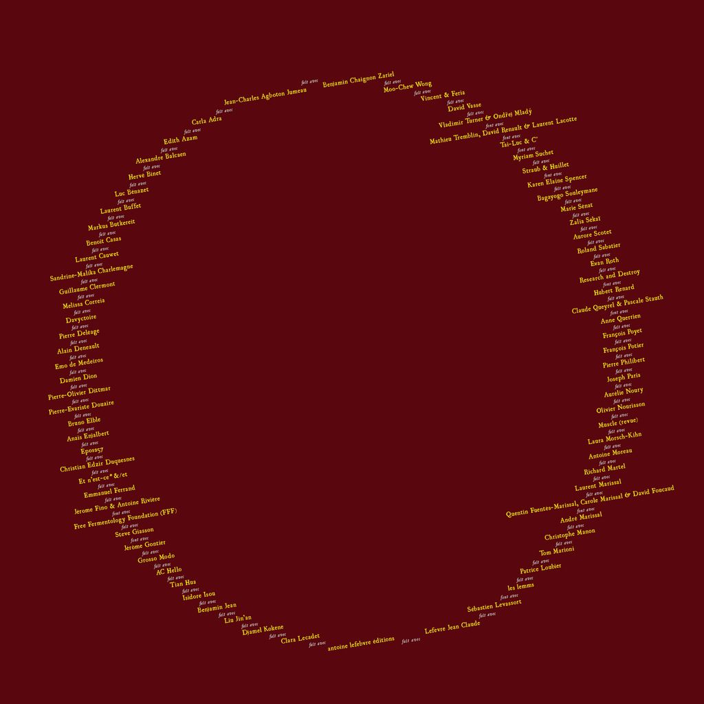

**25-26 novembre 2017 / Festival Non-Aligné(e)s, AN 0 :**

 **cellule(s) dormante(s) / Exposition, happening, salon**

à la Générale, Coopérative artistique, politique et sociale

14, av. Parmentier Paris XIe – M° Voltaire

**L’AN 0 du festival non-aligné(e)s \[FNA\] sous-titré _Cellule(s) dormante(s)_, lève un coin du voile sur une partie immergée ou sous-exposée des pratiques symboliques _contemporaines_, pour autant qu’en effet, « _seul peut se dire contemporain celui qui ne se laisse pas aveugler par les lumières du siècle et parvient à saisir en elles la part de l’ombre, leur sombre intimité et reçoit en plein visage le faisceau de ténèbres qui provient de son temps_ ». _Ergo_, poursuit Giorgio Agamben, la « _voie d’accès au présent a nécessairement la forme d’une archéologie_ » qui, détourne intempestivement « _la lumière, hors de sa fonction d’illumination du présent, vers l’assignation de l’infini, de l’invisible, de l’inatteignable_ », comme Jean-Luc Marion en convient lui aussi.**

**Le \[FNA\] prend acte de ce que les institutions (et le [marché](https://news.artnet.com/market/gray-market-why-museums-cant-compete-with-private-collectors-1109903?utm_content=from_&utm_source=Sailthru&utm_medium=email&utm_campaign=Europe%20October%209&utm_term=New%20Euro%20%2B%20Newsletter%20List) dont elles dépendent sous peine de mort désormais), sont respectivement l’arbre et son ombre qui cachent la forêt. Le festival inventorie donc, dans un lieu [coopératif](https://www.lagenerale.fr/) par excellence, des pratiques artistiques, symboliques ou savantes, minoritaires ou dissidentes qui, inscrites à la limite de la lisibilité institutionnelle et/ou de la solvabilité marchande, s’avèrent indifféremment : _–_ _alternatives_ _–_ _(an)alphabètes_ _–_ _anaparachroniques_ _– autonomes –_ _é__mancipatrices_ _– expérimentales – (im)personnelles_ _–_ _marginales_ _– singulières, &c._**

**Le \[FNA\] veut ainsi rendre possibles des : _–_ _agencements_ _– complicités_ _– dé(con)structions – perruques_ _– sabotages – rhizomes – solidarités – subversions – &c._ qui, inactuels, inédits & cosmopolites, s’étendent à perte de vue quelque part dans l’inachevé ou dans l’ineffectué …**

**\+ Deux concerts acoustiques de _La Souris Déglinguée._  
\+ Un film de Straub et Huillet projeté dans un camion 19 tonnes généreusement prêté par la société _Vasse Déménagement d’Entreprises_.**

**Une proposition mise en scène par Jean-Charles Agboton-Jumeau, [critique d’art](http://criticavitjkj.blogspot.fr/), & Laurent Marissal, [peintre](http://www.laurentmarissal.net/2017/01/nada-n-34-et-galette-des-jacobins.html).**

**Zalia Sekai, Happening subliminal : la conférence de Bandung.**

Liste des participants
