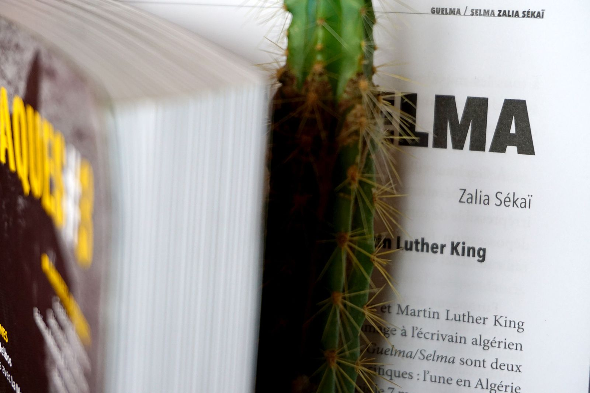

La revue ATTAQUES#3 organisée par [Laurent Cauwet](https://www.facebook.com/laurent.cauwet?__cft__[0]=AZUl_-Act5UC4uFKbszXefwJDLzqhi8zibePLoIGXraq0pAaShUzT761mbc5OoJebTy4R96E38-Rh9mR5kjg8pw2klknv1MbUdelTVlnta_LOFSD6qksklVKDCihDsVBmJM&__tn__=-]K-R) est une revue de poésie critique qui croise des interventions (poétiques, artistiques, théoriques) d'auteur.e.s d'Europe, du continent africain et d'Amérique latine. Elle se réfléchit et se construit sur des bases décoloniales, en confrontant les réalités et les modernités des différents continents, des différents pays – et refuse ce à quoi l'institution travaille : les « formalismes d'avant-gardes », en réinterrogeant la notion d'engagement.

Disponible sur le site [https://www.lespressesdureel.com/ouvrage.php?id=8646&menu=2](https://www.lespressesdureel.com/ouvrage.php?id=8646&menu=2&fbclid=IwAR25A102mLwu4TzoVUOeHP3j77KhphKvjYW4HZpKLmX_uy96tN4wYA5Ca2Y)
