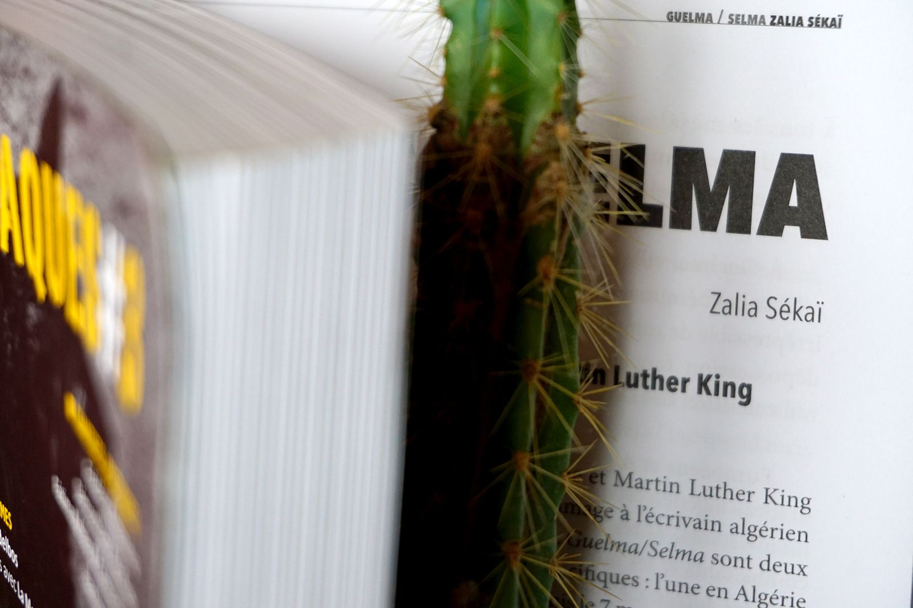

La revue ATTAQUES#3 organisée par [Laurent Cauwet](https://www.facebook.com/laurent.cauwet?__cft__[0]=AZUl_-Act5UC4uFKbszXefwJDLzqhi8zibePLoIGXraq0pAaShUzT761mbc5OoJebTy4R96E38-Rh9mR5kjg8pw2klknv1MbUdelTVlnta_LOFSD6qksklVKDCihDsVBmJM&__tn__=-]K-R) est une revue de poésie critique qui croise des interventions (poétiques, artistiques, théoriques) d'auteur.e.s d'Europe, du continent africain et d'Amérique latine. Elle se réfléchit et se construit sur des bases décoloniales, en confrontant les réalités et les modernités des différents continents, des différents pays – et refuse ce à quoi l'institution travaille : les « formalismes d'avant-gardes », en réinterrogeant la notion d'engagement.

Disponible sur le site [https://www.lespressesdureel.com/ouvrage.php?id=8646&menu=2](https://www.lespressesdureel.com/ouvrage.php?id=8646&menu=2&fbclid=IwAR25A102mLwu4TzoVUOeHP3j77KhphKvjYW4HZpKLmX_uy96tN4wYA5Ca2Y)

En librairie en juin 2021

Sommaire :

OUVERTURE(S) avec Pierre Chopinaud, Ismaël, Seloua Luste Boulbina

DE LA RESTITUTION avec Seloua Luste Boulbina

DES IDÉES DES OUTILS DES ARMES avec Jan Middelbos et La Meute

MEXIQUE : POÉSIE DES PEUPLES ORIGINAIRES

par Florence Malfatto

& avec José Vicente Añaya, Kalu Tatyisavi, Feliciano Sánchez Chan, Andrés López Díaz, Juan Alvarez Pérez, Samuel Cedillo

SOUDAN : LES POÈTES DE LA RÉVOLUTION

par Hind Meddeb

& avec Khalil Farah, Mahjoub Sharif, Azhari Mohammed Ali, Hashim Siddig, Youssef Elbadawi Hamad, Nylawo Ayul, Samah Musa Al Tahir

POLÉMIQUE ET DÉBATS avec Ahmed Slama

NOTRE HISTOIRE EST TOUJOURS DEMAIN

Alexandre Costanzo Sur quelques dessins de Kafka

Légitime défense Surréalisme & colonialisme

CHANTIERS POÉTIQUES

avec Frédéric Acquaviva, Démosthène Agrafiotis, Fátima Azhara & Carmen Virusa, Joachim Ben Yacoub, Julien Blaine, Hamideddine Bouali, Laura Boullic, Sylvain Courtoux, Georges Daaboul, Rachel Defay-Liautard, Justin Delareux, Carmen Diez Salvatierra, Khalid El Morabethi, Claude Favre, Luc Fierens, Liliane Giraudon, Jean-Marie Gleize, Malek Gnaoui, A.C. Hello, Amal Khlif, Éléonore Léger, Fabienne Létang, Hubert Lucot, Vannina Maestri, Laurent Marissal, Michèle Métail, Chiara Mulas, Stéphane Nowak Papantoniou, Clemente Padín, Matina Papagiannopoulou, Maya Paules, Élodie Petit, **Zalia Sékaï**, ValK, Laura Vega Blanco, Nicolas Vermeulin
