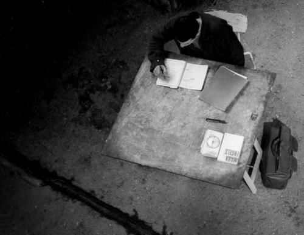
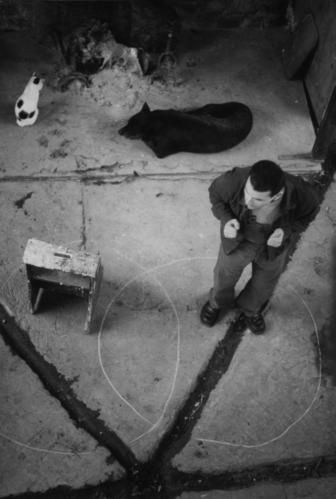

L’IDENTITÉ EN FRAGMENTS  

_(Article publié dans UBU scènes d’Europe N° 27/28 juin 2003)_  

Les Franco-algériens ne sont pas les représentants d'une seule culture, ils ne sont ni même dans l'entre-deux. Ils prennent part dans les deux ensembles et ne prennent pas position pour un ensemble. Leur identité n'étant pas une et indivisible, ils ne sont pas identifiables dans un ensemble bien défini. Ils occupent un espace inédit.  

L'appréciation des créations culturelles, ici l'espace théâtral, peut rendre compte de quelques éléments fragmentaires qui constituent une identité plurielle et mobile et non pas une identité unique et figée. L'identité réelle est à lire derrière celle, visible, qui nous est donnée, lecture chaque fois à renouveler. En même temps que le théâtre fait partie du mécanisme d'acculturation 1 , il est l'indicateur du niveau "d'acculturation", du rapport entre soi-même et l'autre : participation, assimilation, transformation... des cultures. La création franco-algérienne serait à "appréhender" en termes d’un nouveau genre, difficile à identifier. Par conséquent, présenter et apprécier quelques personnalités de "ce" théâtre n'est pas le gage d'une représentativité.\*\*  

**« Ne te crois jamais arrivé, partout, tu es un voyageur en transit » 2**

La terminologie utilisée pour désigner les générations nées en France issues de l'immigration algérienne est mouvante et prolixe : enfants ou générations issues de l'immigration, Français d'origine algérienne (par opposition aux Français de souche), Beurs, Franco-algériens,…. Elle est le reflet d'une difficulté d'identification due à une constante mutation de ces identités. Ces tentatives de nommer, d'inscrire leur être et leur devenir dans les limites d'un signifiant, conditionnent une image et un statut, source de conflits identitaires. Ces identités meurtrières  3 renvoient à la qualité d'étranger (différence, écart culturel) et au statut immigré (différence socio-économique) de leurs parents. Cette image reste pregnante au-delà de la première et seconde générations. Alors même qu'une grande majorité d'entre eux ne connaît pas leur pays d'origine.  
Les qualificatifs d'étranger et d'immigré confèrent un statut d'infériorité par rapport aux nationaux du pays d'accueil, auquel vient s'ajouter le facteur de colonisation qui impose de facto une image inférieure du maghrébin et du musulman. L'immigré est un inadapté de par sa culture, son niveau social, sa langue, son physique.  
"Beur" est une appellation que se sont attribué ces générations au moment des manifestations des années quatre-vingt revendiquant dans le même temps le droit à la différence et le droit à l'égalité. Mais ce terme a tendance à stigmatiser ces générations dans leur différence. L'étranger est à cette époque déterminé par sa “distinction“. Puis les années quatre-vingt-dix introduisent la notion d'intégration. Ici l'étranger est déterminé par son “assimilation“.  
Aujourd'hui, il est question de multiculturalité, terme apparu tardivement en France (apparu au Canada en 1965 et dans les pays anglo-saxons dans les années quatre-vingt). Car la France a une conception plus “assimilationniste“ que pluraliste de la gestion de la diversité. Cette conception s'inscrit dans une tradition jacobine et républicaine qui relègue les particularismes culturels à la sphère privée, l'espace public étant un espace laïc et neutre. Ces années deux mille entendent parler de Franco-Algériens, de Français d'origine maghrébine, de métissage culturel, impliquant une vision interculturelle et de cohabitation. Ces générations opposent légitimement un refus de se définir en termes ethniques, un refus de la communautarisation et de l'intégration. Car l’assignation identitaire a des conséquences sur la liberté et l'autonomie de ces personnes et apporte un éloignement avec la culture légitimée (la culture française). Les classifications sont souvent en dehors de la réalité socio-culturelle et rendent difficilement compte des processus de métissage et d'acculturation. Ainsi comment définir l'appartenance identitaire d'une jeune banlieusarde parisiennne d'origine maghrébine, Kabyle, née à Nanterre, musulmane non pratiquante, universitaire ou professeur…?  
“Pour être représentative, l'identité devrait prendre en compte non seulement qui nous avons été mais aussi qui nous sommes en train de devenir.“  
Les différentes assignations d'identité, au fil du temps et de l'espace, montrent bien, d'une part que l'identité est complexe et multiple, et d'autre part qu'elle n'est pas immuable car elle évolue avec le contexte socio-politique. Il s'avère alors très compliqué de mener des études relatives à ces groupes, quelles qu'elles soient.  
Il faut souligner par ailleurs que la définition de sa propre identité dépend de sa place sociale acquise en France et de ses capacités individuelles de dépassement du "conflit". Elle se rapprochera d'autant plus des valeurs françaises que ses capacités d'analyse et de distanciation seront élevées et que la réussite sociale sera importante (les problèmes socio-économiques souvent révèlent voire sont à l'origine des conflits identitaires).  
L'assignation d'identité est préjudiciable aussi bien en France qu'en Algérie où les enfants d'immigrés ainsi que leurs parents de par l'histoire (voir infra), sont assimilés en Algérie à des Français, des émigrés, des gens qui ont abandonné et trahi leur terre car il y a désormais une autre culture de référence. La méfiance persiste, même dans la création. Les écrivains "beurs" de langue française ne sont pas considérés comme des Algériens par la communauté algérienne. Nedjma même de Kateb Yacine écrit en France en 1956 n'est pas considéré par certains écrivains algériens, comme une œuvre algérienne !  4  
La légitimité, pour ces générations, d'aborder le thème de l'Algérie en est contestée. Les parents qui ont joué un rôle important dans la guerre sont suspectés de francisation (pour leur prise de position politique car ils furent en majorité messalistes opposés au FLN), rôle d'ailleurs oculté par l'État algérien.  
La seule légitimité pour s'exprimer sur l'Algérie est celle du sang et du sol : naître Algérien et vivre Algérien.  
Ainsi, l'assignation d'identité des individus s'est répercutée sur leur création. Dans les années quatre-vingt, les préoccupations des Franco-algériens furent celles de l'immigration même, c'est-à-dire la reconnaissance de la différence, de la revalorisation et de la sauvegarde culturelles. Par conséquent, le lien avec le pays d'origine est revendiqué. Les propos dans l'art, livrés en langue française, sont combatifs, libérateurs comme si la véritable libération n'était pas encore acquise… Les noms des troupes sont révélatrices : La Kahina, Nedjma,… Les influences sont Kateb Yacine, Armand Gatti, Augusto Boal,… Dans les années quatre-vingt, le théâtre dit "beur" et l'art "beur" en général, sont remarqués non pour leurs qualités intrinsèques mais pour l'identité de l'artiste, ses origines. C'est le théâtre ethnique, lui-même porteur d'exclusion. Cette pratique d'édition semble s'inscrire dans une politique commerciale et du politiquement correcte.  
À la suite de ce théâtre ethnique apparaît un théâtre fonctionnel, remarqué pour sa fonction, celle de l'intégration sociale (voir l'action des MJC par exemple) et non pour ses qualités. La littérature devient une école, une thérapie, un modèle d'intégration. Comme si la qualité de l'œuvre passait au second plan. Comme si cette catégorie d'individus était de facto vouée à l'échec et conservait l'image de l'opprimé, de l'éternel assisté, l'éternel second. On assiste à un théâtre à deux vitesses parce qu'il y a une citoyenneté à deux vitesses qui s'inscrit dans les rapports Nord/Sud. Parce ce qu'il y a des beurs, il y a nécessairement un théâtre…beur. L'art entre donc dans la seule problématique identitaire et s'installe dans le malaise identitaire... "(…) ces espaces sont considérés comme relevant de l'anthropologie, ou de l'ethnographie, et dès lors on conçoit mal qu'ils puissent produire des littératures."  5  

Par-delà les assignations d'identités précises et immuables, il semble plus juste de voir dans cet espace polymorphe, hic et nunc, un agencement d'éléments différents, dans lesquels certains sont conservés, absorbés, effleurés, d'autres rejetés ou encore transformés. Nous allons aborder succinctement le rapport à l'histoire, la communauté, la mère, aux femmes, au corps, au débat et à la multiculturalité.\*\*  

**Théâtre de l'histoire**

Un des éléments constitutifs de l'identité est la mémoire du passé et du présent, de l'histoire. D'une immigration de main-d'œuvre nous sommes passé à une immigration de peuplement 6 , où les revendications sociales et politiques sont plus présentes et où le droit de cité, d'existence sociale, par les productions culturelles par exemple, est affirmé. On assiste ainsi à une profonde mutation du projet migratoire. Les enfants et les petits-enfants naissent en France. Même si les textes algériens inscrivent le retour des immigrés au pays, il n'en est rien.  
Ces générations souhaitent être des citoyens français tout en respestant la tradition des pères qui ont combattu pour l'indépendance de l'Algérie et qui ont, par la suite, fait le sacrifice de l'exil. Elles affirment le refus, et du communautarisme et de la situation coloniale. Toutefois, le nationalisme et le refus d'intégration, justifiés pendant la guerre coloniale, semblent être encore présents dans l'esprit des acteurs de la Libération.  
Comment dès lors concilier l'histoire du père nationaliste et sa citoyenneté française ? Comment revendiquer une appartenance spécifique et s'inscrire dans une citoyenneté républicaine dont l’un des principes fondamentaux est d'affranchir les individus de leurs multiples appartenances primaires ?  
Force est de constater que l'aspect politique et historique est nécessaire dans la recherche de son identité. A fortiori lorsque l'histoire de la guerre d'Algérie reste taboue en France et fait l'objet de désinformation en Algérie. Le rôle joué par l'émigration pendant la guerre est occulté par l'État algérien. L'État français se résout récemment à ne plus parler d'événements mais de guerre. La reconnaissance de la guerre d'Algérie en octobre 1999 aura-t-elle un effet sur cette recherche d'identité ? La citoyenneté des enfants sera-t-elle effective que lorsque sera reconnue celle de leurs parents ?  
Pour construire son identité, il s'avère nécessaire d'intégrer l'histoire des pères et la culture des traditions dans la réalité, quel que soit le support utilisé (théâtre, roman,…) tout en dépassant le seul cadre de l'engagement, l'esthétique (la forme) pesant autant que le combat d'idées (le fond).\*\*  

**"La famille est l'alpha et l'oméga de tout le système (…)."  7**

La structure communautaire répond au souci d'indivision globale : conserver la Maison, la Terre et la Mémoire des ancêtres.  
L'espace du théâtre semble être un espace dans l'espace ; et plus encore pour le théâtre "franco-maghrébin" un espace dans l'espace dans l'espace, une recréation de la cellule communautaire, d'une sphère plus réduite, sécurisante (à l'instar des associations) où il y a valorisation et reconnaissance de soi. La cellule théâtrale procure un sentiment d'appartenance collective. Paradoxe, cet espace n'en reste pas moins un espace public. Le théâtre c'est ne plus mettre ses différences dans la seule sphère privée mais leur donner une place dans l'espace public. Îlot "d'isolement dans la visibilité" 8 .  
Il permet la réalisation de la citoyenneté tout en recréant l'espace communautaire. Le théâtre mesure son rapport à l'autre (le dehors) et à soi-même (le dedans), la visibilité dans la pudeur.  
Il construit autre chose qu'un territoire précis et identifiable, c'est le lieu de la déterritorialisation. 9  Ce territoire instaure une distance critique entre les individus, ce territoire n'étant pas la localisation d'un espace fermé.  
Mais le risque d'enfermement communautaire est toujours présent. Et le théâtre de territoire, endogamique existe dans certaines troupes, certains milieux associatifs,...  

Cet esprit communautaire est associé à la mère et à la langue. Ainsi, à la troisième génération, on constate une forte déperdition de la langue d'origine. 87 % des jeunes d'origine algérienne ayant des parents immigrés déclarent le français comme langue maternelle.  
Comment dès lors faire face à ce manque de présence de la mère, à son éloignement, à l'apparent ensevelissement de la mère-patrie, de la filiation ?  Le théâtre semble répondre à cette préoccupation. Il est l'oralité et l'écriture. D'une part, il revalorise l'oralité, par conséquent la mère car la parole se rapporte à la mère. "L'oralité est toujours présente en elles (les littératures de l'exiguïté), comme si elles avaient pour but ultime de faire parler l'écriture."  10  D'autre part, l'écriture est la mémoire dont les parents ont été privés.  
La mère est désignée comme étant le fief de la culture. C'est à elle et non à l'institution que revient la charge de la transmission de la perpétuation de l'identité, via un enseignement informel de la langue. Défenseur de la langue, gardienne de la tradition, c'est par elle que s'achemine et vit toute la culture orale, d'où l'importance de l'oralité.  
Dans le théâtre et plus globalement dans l'art, on retrouve cet attachement à la culture maternelle et à l'histoire de son pays, sous forme de fragments plus ou moins explicites des systèmes effondrés ou perdus :  on injecte des chants, des mots, des phrases dans le parler d'origine, car la langue est la représentation du sentiment affectif maternel. Chaque langue tenant son propre rôle : le français, la langue sociale ; le kabyle ou l'arabe dialectal, le parler de l'intérieur.\*\*  

**Le corps et les femmes**

Par ailleurs, le théâtre est l'utilisation du corps, de l'image et de la parole. Et la représentation du corps est liée à l'image du corps dans l'islam (conception variable en fonction des régions et périodes). L'islam prescrit une pratique du corps sain et vertueux. Alors que, comme l'écrit Malek Chebel, anthropologue et psychanalyste 11 , l'usage du corps au théâtre est orienté vers le plaisir et la distraction. Et ce corps jouissif est le fait d'une élite urbaine qui dispose du temps et de l'argent nécessaires pour se livrer aux jeux, divertissements et sports.  
Et plus que tout autre, le corps des femmes est en jeu et un enjeu, dans cet espace. Le théâtre leur est moins accessible car il touche des domaines qui leur sont confisqués : le parler, le corps, le débat, la mixité, l'image, l'espace public…  en d'autres termes l'expression et son identité individuelle... ou encore son existence. Car selon un adage kabyle, la femme est la lampe du dedans et l'homme la lampe du dehors."Le monde des hommes et celui des femmes sont comme le soleil et lune, ils se voient tous les jours, mais ne se rencontrent pas."  (Mouloud Mammeri). L'espace public destiné à être vu, est interdit aux femmes. Encore une fois, nous sommes dans le rapport entre le dedans et le dehors, dans la problématique de la distribution des rôles, de l'assignation d'identité. L'espace public est un espace d'échange, de circulation, d'exposition à l'autre. Ces femmes sont donc exposées au regard des autres, des hommes. "La vue d'une femme sans voile constitue une forme de possession sinon une jouissance achevée" 12 . "Regarder, c'est déjà posséder". 13  
L'homme représente l'affrontement et, inversement la femme l'effacement, le silence, le bas, le refoulement, l'abaissement des yeux. Dans la sourate XXIV verset 31, il est dit "Dis aux croyantes de baisser leurs regards".  
Ainsi, l'investissement de l'espace public par les femmes, l'affrontement du regard masculin et étranger, le non-voilement, la prise de parole, les mouvements du corps, en somme l'expression artistique, transgressent les pratiques culturelles du pays originel.  
Ceci est d'autant plus difficile qu'on observe, aujourd'hui en France, un repli communautaire accompagné d'une cristallisation des valeurs traditionnelles (voile, agression contre les femmes,…) dans les quartiers défavorisés. On comprend dès lors que l'écriture, symbole de pouvoir, est difficilement accesssible aux femmes. C'est pourquoi on peut dire qu'"Une femme qui écrit vaut son pesant de poudre." (Kateb Yacine). D'autant plus que l'écriture théâtrale ouvre un espace laïc qui empêche la cristallisation identitaire et constitue une renonciation au statut de dominée et à tous ses éléments qui permettent d'intérioriser cet état d'infériorité.  
Le choix du théâtre ne va pas dans le sens de la reproduction du modèle familial mais vers l'autonomie. Il s'agit donc d'une rupture avec le modèle communautaire, perçue comme une mauvaise éducation de la fille (remettant en cause les parents) et un manque de pudeur. Ce choix reste un défi à l'égard de soi-même et du groupe familial. Mais pour les hommes cela fait parti du champ des possibles. Pour les femmes, ce choix reste perçu comme un suicide ou un meurtre culturel.  
Si aujourd'hui, les hommes se déguisent et interprètent de moins en moins des rôles de femmes, il n'en reste pas moins qu'elles restent fort peu nombreuses dans l'ensemble du théâtre.  
On le voit, en abordant le thème des femmes au théâtre, c'est tout le système culturel, religieux et traditionnel qui est remis en question.  

**Revendication des paroles confisquées ici et là-bas**

Dans un article remarquable, Françalgérie, sang, intox et corruption, François Gèze 14  dénonce un système algéro-français qui vit sur la corruption, le meurtre et la désinformation.  
En tentant de dénoncer ces pratiques, un certain nombre d'artistes franco-algériens ou algériens sont censurés et mis à l'index, ou intimidés et menacés. Toujours selon F. Gèze, le contrôle serré de la communauté immigrée en France est assurée par la Sécurité Militaire algérienne (aujourd'hui DRS, Département du Renseignement et de la Sécurité). Plusieurs centaines d'agents et des milliers d'indicateurs travaillent à éviter toute structuration d'une opposition au pouvoir dans l'immigration. Ils neutralisent les plus actifs par la récupération et les menaces sur les familles restées au pays. Des comédiens hésitent ainsi à travailler pour des spectacles engagés. Certaines associations, revues, certains médias algériens installés en France (infiltrés)… bloquent la médiatisation de ces artistes ou intellectuels.  
Le débat, quand il n'est pas infiltré, est l’une des revendications de ce théâtre multiculturel. Car il cesse d'être un théâtre d’intégration et communautariste, et c'est une position bien mal considérée par les groupes communautaires de France et d'Algérie. Le questionnement reste-t-il tabou parce que, dans le Coran tout y est écrit et codifié ?  
Pourtant plus qu'une expression, le théâtre est une rencontre et un débat, en rupture avec le non-dit et le non-voir. Le débat consiste dans l'échange de parole avant et après la pièce. Il est suscité par le public qui décide ou non de rester. On remarque que le public est très demandeur, c'est lui qui vient chercher le dialogue, qui lui fait par ailleurs défaut. Parce que l'essentiel se passe avant et après la pièce, le débat pose problème. On sait que pendant la guerre de Libération, le théâtre a servi la Révolution. "Le FLN, qui mesura l'importance du fait artistique dans la lutte de libération, fit appel à tous les artistes algériens pour rejoindre la lutte de libération." 15  
J'évoquerais ici ma propre expérience et celle de la compagnie SLND, avec la pièce En Attendant l'algérie 16.  
L’amphithéâtre antique fut le lieu du débat public, et c’est avec cet esprit que nous voulons renouer. Chaque soir, ou presque, un invité intervient au cours de la pièce. À cet instant, un projecteur éclaire l’invité qui reste assis au  milieu du public. Pendant dix à quinze minutes, il s’exprime. Puis le projecteur s’éteint : il redonne la parole au comédien. Le moment de cette intervention est déterminé avec l’auteur en fonction du contenu de son discours afin qu’elle s’insère au mieux dans le corps de la pièce.  
Notre objectif est de décentrer la parole : l’auteur, à travers le comédien, n’est plus le seul à s’exprimer. Le choix des intervenants est indépendant de notre engagement. Et le public n’est pas informé de son identité. Il sait seulement qu’il y aura un invité. Notre objectif est d’initier le débat, d’annuler l’effet tyrannique d’une seule parole donnée, en apportant des voix multiples. Celles-ci ne sont plus représentées (le comédien récitant le texte d’un autre), mais libres. Si ce lieu qui n’a pas encore de lieu en cherche un, c’est que l’espace que nous occupons et voulons circonscrire le temps de cette représentation n’appartient plus à son directeur, n’appartient pas à l’auteur, au comédien ou au metteur en scène, il n’appartient pas non plus au public, il est devenu une surface de tension et d’échange. Nous voulons faire entendre des voix qui ne soient plus théâtrales, nous voulons que les ombres fassent place aux vivants. 17

**Multiculturalité (revendication de la) : la démocratie à l'épreuve**

On constate, en s'interrogeant sur l'identité des générations issues de l'immigration, que l'on questionne d'une part l'identité de la France (la Nation française est-elle plurielle ?) ; d'autre part l'identité du pays d'origine (son niveau de démocratie).  
Ainsi, dans l'espace théâtral, la multiculturalité et la démocratie sont à l'épreuve. Espace iconoclaste où se cotoient des valeurs différentes qui lient malgré la séparation, le théâtre se réfère à deux systèmes culturels différents. Il y intègre des langues, des musiques différentes,… Et il tente de s'en affranchir, sortir des schémas et images véhiculés depuis la colonisation à savoir l'esprit dominant pour les Français et l'esprit nationaliste pour les immigrés. C'est l'espace perméable où l'on y inscrit sa propre identité. Théâtre de modernité car la modernité c'est la liberté de rompre ou d'adhérer à certains éléments culturels, le théâtre de ruptures, de la transformation des frontières. Il est un espace qui n'a pas de lieu, apparemment affranchi du sentiment d'aliénation.  
Même si, et on le sait, nous sommes dans un contexte de domination culturelle (nous sommes dans la culture d'accueil dominante) où les apports de cette culture sont importants. C'est l'acculturation. Toutefois, les revendications multiculturelles peuvent dériver vers des formes d'intolérance et de rejet de l'autre. C'est le cas du théâtre berbéro-berbère car il encourage indirectement l'auto-exclusion des groupes qu'il prétend protéger et promouvoir en les tenant en marge de la communauté dominante. Elles dérivent vers la discrimination et la folklorisation, le cloisonnement.  
Pourtant la révolution multiculturelle est un approfondissement de la démocratie pluraliste. "Plus vous vous imprégnez de la culture du pays d'accueil, plus vous pourrez l'imprégner de la vôtre."  
Et "Plus un immigré sentira sa culture d'origine respectée, plus il s'ouvrira à la culture du pays d'accueil" (Amin Maalouf, romancier et essayiste franco-libanais).  
Robert Park, dans son article "La ville", montre que plus l'homme est lié à son territoire, moins sa capacité à l'abstraction est grande 18 , en d'autres termes, moins la prise de conscience, l'ouverture d'esprit sont facilitées. La cohabitation interculturelle doit permettre de gérer les contradictions et ressemblances, éviter l'imitation, l'exotisme, l'adaptation absolue ou la non-conformité. En fait, notre identité la plus accomplie n'est-elle pas le "moment où l'analyse la plus fine ne peut plus distinguer entre ce qui m'appartient et ce qui me vient d'ailleurs" 19  ?

**Théâtre de la conscience**

Aujourd'hui, on ne semble plus mettre en avant un type particulier de théâtre. À la non-médiatisation du théâtre "franco-maghrébin", nous avançons les hypothèses suivantes :  
Celle d'un théâtre qui n'a jamais existé en tant que théâtre franco-algérien car il s'agit là d'un faux concept.  
D'un théâtre non accessible à la population maghrébine car dans sa majorité issue d'un milieu social défavorisé (recrudescence des problèmes sociaux), et où la tradition théâtrale algérienne n'existe pas. En effet, le théâtre en Algérie n'apparaît qu'au début du siècle par l'effet d'influence des troupes égyptiennes et françaises.  
D'un théâtre "intégré" dans la culture française dominante. L'aspiration à l'égalité tend-elle à l'emporter sur celle de la revendication du droit à la différence ?  
D'un théâtre censuré pour son engagement militant. Est-il porteur d'un discours trop ouvert et moderne, bousculant la notion d'État-nation ?  
D'un refus du théâtre, lié à un repli identitaire. Un repli qui peut s'expliquer par les difficultés socio-économiques, l'impossibilité de dépassement des conflits identitaires (pas de dialectique), les attitudes nationalistes. Ce repli s'exprime par le refus des mœurs occidentales et le retour en force de traditions musulmanes.  
 De même, la notion de multiculturalité a du mal à s’imposer dans les Etats jacobins, telle la France, qui donnent la préférence à l’unité nationale, la multiculturalité tendant à bousculer la notion d’Etat-nation. C’est l’échec de la multiculturalité.  
Des deux côtés de la Méditerranée, les générations franco-algériennes sont à la fois proches et lointaines. Elles sont de moins en moins identifiables aux groupes d'appartenance d'où elles sont issues et au groupe social dominant. Elles jouent elles-mêmes un rôle actif dans la création : affranchissement de certains codes communautaires, mobilisation des ressources personnelles. "L'espace devient ce qui empêche que tout soit à la même place." (Paul Virilio). Place de la langue, du corps, du geste, de la parole,… Cette fragmentation ne permet plus de les identifier précisémment. Une des raisons de cette fragmentation ne se situe-t-elle pas dans cette politique intégrationniste française qui ne valorise pas la diversité identitaire des minorités ? La revendication de la multiculturalité semble difficile car les discriminations sont importantes en France.  
La problématique de ces générations est celle du particulier et de l'universel. Comment penser l'égalité en la réconciliant avec les différences ?  
Le théâtre tente de mettre en œuvre le droit à la différence et à l'indifférence. Il constitue une participation active à la société nationale, donc une réalisation de la citoyenneté et non la conformité aux valeurs et mœurs dominantes. L'artiste crée, élabore son identité propre, sort de l'attribution identitaire unique, de l'image "d'agents de développement", afin de faire émerger une identité sociale réelle et non plus virtuelle (celle qui lui est attribuée).  
Les revendications sont inscrites dans des préoccupations et une réalité universelles telles que l'on ne peut pas parler d'une catégorie de théâtre beur. Le but n'étant plus d'affirmer un genre de théâtre. C'est un théâtre moins théâtral car il n'y a pas de culture théâtrale algérienne. D'autre part, il ignore les frontières entre les genres. C'est souvent le texte qui prime sur le spectacle, c'est le texte qui circule. Mais cet esprit est souvent qualifié de non professionnel.  
C'est simplement le "Théâtre de la conscience, non de l'action, du problème, non de la réponse" (Roland Barthes).  

\*\*  

**BIBLIOGRAPHIE**  

  1) "Ensemble des phénomènes qui résultent d'un contact continu et direct entre des groupes d'individus de cultures différentes et qui entraînent des changements dans les modèles (patterns) culturels initiaux de l'un ou des deux groupes". D. Cuche, La notion de culture dans les sciences sociales, La Découverte, coll. Repères, 1996, p. 54  
 2) Edmond Jabès, cité dans Le multiculturalisme, Fred Constant, éd. Dominos Flammarion 2000, p. 92  
 3) Amin Malouf, Grasset, 1999  
 4) In Jean Déjeux, Maghreb. Littératures de langue française, Arcantère, 1993, p. 174.  
  5) Charles Bonn, Littérature comparée et didactique du texte francophone, L'Harmattan, Université Paris XIII, 1999, p. 13  
  6) Didier Lapeyronnie, Immigrés en Europe. Politiques d'intégration, La Documentation française, 1992, p. 11 (cité dans Que sais-je ? 3292)  
  7) Pierre Bourdieu, Sociologie de l'Algérie, PUF, 1970  
  8) Alain Milon, Du rap au graff mural, PUF, 1999, p. 18  
  9) Gilles Deleuze, Félix Guattari, Mille plateaux, éd. de Minuit, 1980, p. 403  
  10) François Paré, Les littératures de l'exiguïté, Hearst, Ontario, éd. Nordir, 1992, p. 25, cité dans Habiba Sebkhi, Une littérature "naturelle" : le cas de la littérature "beur"  
  11) Voir la revue Cassandre, Théâtres des mondes arabes, hors série n° 3, 1999, p. 9, (Entretiens avec Malek Chebel)  
  12) Malek Chebel, L'esprit de sérail, chap. IV, Voile et sexualité, Petite bibliothèque Payot, 1995, p. 115 et suivantes  
  13) Assia Djebar, L'amour, la fantasia, 1985, Paris, J.-C. Lattès  
  14) Mouvements, n° 21-22, 16 mai 2002  
  15) Ahmed Cheniki, Le théâtre en Algérie. Histoire et enjeux, Edisud, 2002, p. 34.  
  16) Zalia Sékaï, éd. Passerelles, 2003  
  17) À titre indicatif, quelques intervenants lors des représentations à la Ferme du bonheur en février-mars 2001 : Mohamed Benrabah, sociologue-linguiste ;  Djillali Hadjadj, journaliste d’investigation ; Gyps, humoriste et dessinateur de presse algérien ; Nassera Dutour, présidente du collectif des disparus ; Gilbert Grandguillaume, sociologue ; Yasmina Boudjenah, députée européenne, délégation «Bouge l’Europe» ; Dominique Caubet, professseur d'arabe maghrébin ; Hamid Salmi, ethnopsychiatre ; Christian Freu, citoyen ; Saïd Bouamama, sociologue ; Meriem Derkaoui, présidente du Relai des associations algériennes des femmes démocrates (RAAFD) ; Roger des Prés, propriétaire de La Ferme du Bonheur ; Madjid Laribi, journaliste  
  18) Robert Park , "La ville" in "La communauté urbaine", L'École de Chicago, Paris, Aubier, rééd. 1990, p. 101 cité dans Alain Milon, "L'étranger dans la ville", PUF, 1999, p. 68  
  19) Albert Memmi cité dans Habiba Sebkhi, Une littérature "naturelle" : le cas de la littérature "beur", Itinéraires et contacts de cultures, Paris, L'Harmattan et Université Paris 13, n° 27, 1er semestre 1999\*\*
