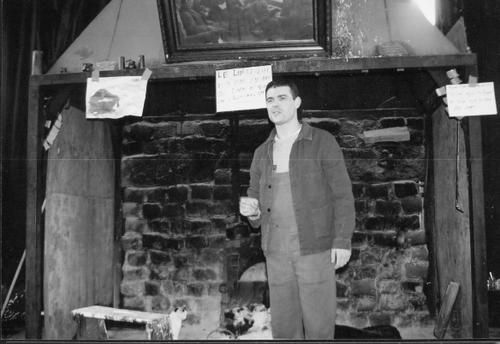
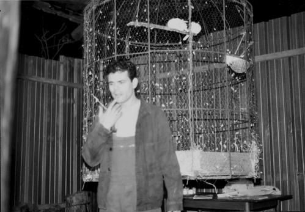

**Cette pièce est un hommage rendu à Kateb Yacine dont l'oeuvre et les entretiens ont permis de réaliser cette pièce qui témoigne d'une pensée résolument tolérante et qui condamne toute forme de discrimination et d’oppression.**

  
Cette pièce a été jouée notamment à la Ferme du bonheur à Nanterre, à l'Epée de bois Cartoucherie Vincennes, à la Laiterie/Hall des chars à Strasbourg.  

**KATEB YACINE**

Ecrivain algérien, né en 1929 à Constantine, il meurt en 1989 à Grenoble. Il s'est livré à une lutte farouche contre l'oppression, les exclusions, les intégrismes.  
Il se voue au théâtre engagé, dénonçant fanatismes et exploiteurs de tous bords et milite pour une culture libre et vivante. Pour cela, il s'exprime avec la langue du peuple, des opprimés dont il s'est toujours senti solidaire. Dans un langage violent, il questionne l'histoire, le pouvoir, l'oppression, le rapport pouvoir/peuple.  
Il passera de l'écriture à l'oralité dans les années 70, en suspendant l'écriture, pour " un théâtre vivant actif ". Il vise par la réactivation de la tradition populaire à retrouver un impact idéologique et didactique. Ce qui lui fait dire que  "Ceux qui veulent se taire peuvent mourir."  
Ses engagements sont lourds à assumer : accusation de traîtrise, suppression des aides et subventions des institutions, refus de publication, interdiction de jouer, sabotages,...  
Le lendemain de sa mort (28 octobre), l'imam égyptien Mohamed El Ghazali  déclarait à la radio algérienne : "Il ne doit pas être enterré dans un cimetière musulman.". Ce qui n'a pas empêché le peuple algérien d'accompagner le poète jusqu'au cimetière d'Alger.  

Son oeuvre :  

- poèmes : Soliloques  
- romans : Nedjma , Le polygone étoilé  
- écrits journalistiques  
- pièces de théâtre : Le cercle des représailles,Mohammed prends ta valise, la voix des femmes...  

**TRAME de la PIECE**

**Un homme se lance dans une diatribe dénonçant le ravage, la déliquescence de l’algérie, ce pays en chantier. Il égrène méthodiquement ses pensées (frustration, aliénation, malaise identitaire) ponctuées de musiques et de chants, dévoilant les blessures d’une algérie asthmatique, s’adressant tantôt au peuple, tantôt aux fondamentalistes, tantôt aux détenteurs du pouvoir, apportant une note finale de mobilisation : A moi mes actes, à vous les vôtres.**  

**STRUCTURE du TEXTE**

La pièce s'ouvre sur l’origine sémantique du mot algérie, révélatrice de l'étendue du problème identitaire algérien, posé en premier lieu par le titre même, et les caractères typographiques utilisés :  En Attendant l’algérie, où le A majuscule de "Attendant" symbolise une attente démesurée face au _a_ minuscule italique tombant de "_a_lgérie" qui indique que le pays, le peuple algérien dans sa dimension d'acteur légitime est bafoué. C’est une remise en cause de la nation, dans le sens où il n’y a pas de coexistence des différentes identités, de volonté de vivre ensemble.  

L'histoire de l'algérie est celle d'une frustration semblable à la vie affective de Kateb Yacine pour qui Nedjma (amour déçu) sera l'objet d'une frustration toute sa vie durant. La frustration de ne pas exister, d'insatisfaction permanente, de déstabilisation, de quête.  
Cette frustration est rendue visible dans le texte : le mot "algérie" n’est pas prononcé excepté dans la première partie où le sujet est précisément défini. Ce mot est remplacé dans le corps du texte par Nedjma (titre de l'un de ses romans et prénom de son amour déçu), elle, pays,...  
En effet ce pays dans ses différentes composantes (ethnique, religieuse, linguistique) est en attente d'exister. L'algérie peut se définir comme un non-lieu parce qu’elle est l’État d'une minorité et non l’État de la société selon les termes de l'historien Benjamin Stora.  
Le nom du pays ne sera plus prononcé et écrit : seul le dessin de la carte géographique de l'algérie viendra clore la pièce.  

La structure adoptée est celle du découpage thématique. Les thèmes abordés sont : l'usurpation de l'histoire, la corruption, les extrémismes religieux, les langues minoritaires bafouées, l'aliénation des femmes, le nationalisme arabe, à la tête desquels des citations sont mises en exergue et à la fin desquels sont insérés des musiques et des chants. Cette pièce se veut un assemblage de matériaux, de repères pour un questionnement sur les difficultés auxquelles doit faire face l'algérie. _Nommer c’est déjà un appel_ (Heidegger).  
La pièce s'achève sur une réflexion sur le théâtre militant qui renvoie directement à l'oeuvre de Kateb Yacine, c'est-à-dire l'osmose entre l'engagement et l'art ; définissant  le théâtre comme étant un acte.  
L'écrivain (et par là même le théâtre) disait-il mène un combat qui dépasse le cadre de la littérature en exprimant les préoccupations d'un peuple sans voix. La tâche quotidienne de l'écrivain, c'est le combat d'idées, et pratiquer le théâtre s'inscrit par conséquent dans cette perspective.  

La pièce débute à l'indépendance, en 1962, à la naissance de l'algérie qui annonce  une rupture  avec l'aliénation colonisatrice, rupture a priori porteuse d'espoirs. Mais elle tombe très rapidement dans la continuité de ruptures, dans un cercle pervers de refus de soi.  
Jusqu'en 1962, l'identité était définie par la volonté de libération. A l'indépendance comment se définir sans faire référence à autrui. Comment retrouver une identité personnelle ?  
Indépendante, l'algérie n'en est pas moins libérée.

L'ENVIRONNEMENT à LA FERME DU BONHEUR  
à NANTERRE  

\*\*

**C'est un théâtre ouvert, où seul un feu de cheminée réchauffe le lieu en plein hiver. Les animaux circulent dans le théâtre EN toute liberté. Chiens, chats, poules font partie du décor.**

  

**Un thé à la menthe est offert au public en fin de spectacle. Le débat peut ainsi continuer par-delà le froid.**
