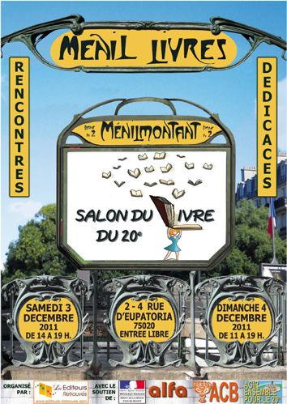
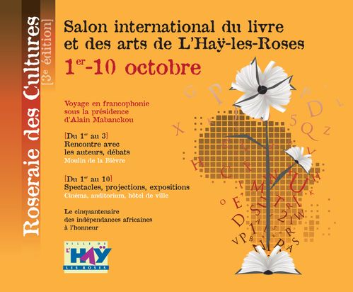
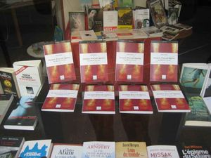
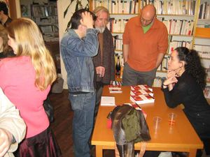
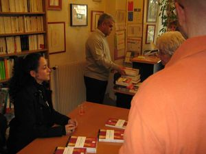
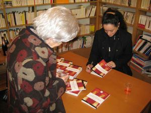
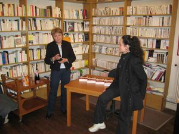
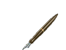

**RENCONTRE AU SALON DE LA POÉSIE A PARIS**

**_le vendredi 22 octobre 2021_**

**RENCONTRE AVEC L'AUTEURE 5**

**_le samedi 3 décembre 2011_**

_\*\*  

**_Lux Beauté à la rose, Autopsie d'un exil algérien,_**

**à l'occasion du salon Menil Livres** 2 rue d'Eupatoria 75020 Paris

16 h « Écrire l’autre rive » avec : Mohamed Benchicou,  
Arezki Metref, Marie Joëlle Rupp, Nourredine Saadi, Leïla  
Sebbar, Zalia Sekaï.  

**RENCONTRE AVEC L'AUTEURE 4**

**_le mercredi 3 novembre 2010_**

**Présentation de "Autopsie d'un exil algérien"**

**dans le cadre d'une SOIRÉE "ÉCRITURE DE LA TRAGÉDIE EN EXIL"**

**Ont également été présents Lorent Idir et Fadéla Hebbadj**

ACB Paris 37bis rue des Maronites 75020 Paris

**RENCONTRE AVEC L'AUTEURE 3**

**_le samedi 2 octobre 2010_**

**Salon international du livre de la ville de l’Haÿ-Les-Roses**

Dans le cadre de l’Initiative 2010 Année de l’Afrique en France

Année Voyage en Francophonie

**A l'occasion du cinquantenaire des indépendances africaines**

**RENCONTRE AVEC L'AUTEURE 2** 

**_le 5 juin 2010_**

Le mur saint martin, les éditions du Cygne et Zalia Sékaï étaient présents au **mursaintmartin/Snax'kfé**  180, rue saint-martin 75002 Paris

_Le même jour Antoine Moreau vernissait son intervention_ sur le mur saint martin [voir ici](http://lemursaintmartin.over-blog.com/)

**RENCONTRE AVEC L'AUTEURE 1** 

**_le samedi 10 avril 2010_**

 

 

Le livre est disponible à la librairie  Les Lettres du Temps 19, rue Campo-Formio 75013 Paris

