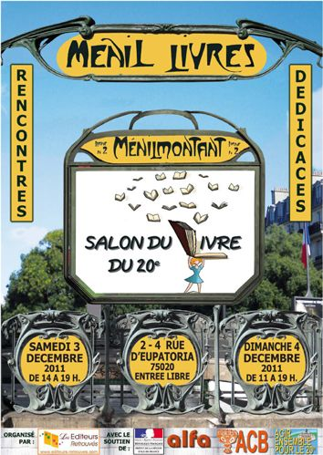
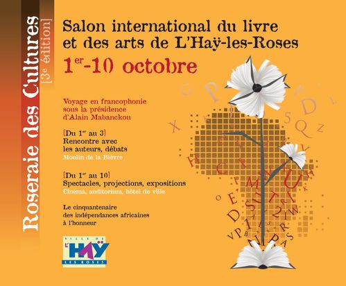
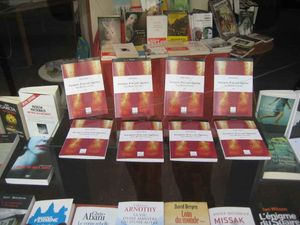
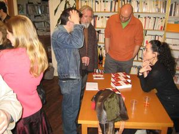
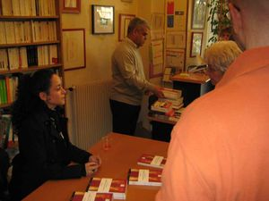
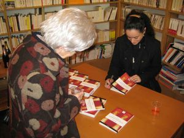
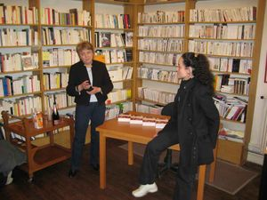

**RENCONTRE AU SALON DE LA POÉSIE A PARIS**

**_le vendredi 22 octobre 2021_**

**RENCONTRE AVEC L'AUTEURE 5**

_**le samedi 3 décembre 2011**_

_**  
**_

**J'ai été ravie que mon ouvrage,** 

_**Lux Beauté à la rose****, Autopsie d'un exil algérien,**_

  **ait été présenté  
**

**à l'occasion du salon Menil Livres**

samedi 3 décembre à partir de 15 heures

2 rue d'Eupatoria

75020 Paris

(métro Ménilmontant)

  
16 h « Ecrire l’autre rive » avec : Mohamed Benchicou,  
Arezki Metref, Marie Joëlle Rupp, Nourredine Saadi, Leïla  
Sebbar, Zalia Sekaï.  

* * *

**RENCONTRE AVEC L'AUTEURE 4**

_**le mercredi 3 novembre 2010**_

**J'ai été heureuse de vous accueillir**

**à une présentation de mon ouvrage "Autopsie d'un exil algérien"**

**dans le cadre d'une SOIREE "ECRITURE DE LA TRAGEDIE EN EXIL"**

**Ont également été présents Lorent Idir et Fadéla Hebbadj**

mercredi 3 novembre 2010 à 19 heures

**ACB Paris  
**37bis rue des Maronites

75020 Paris

tel: 0143582325

  

* * *

**RENCONTRE AVEC L'AUTEURE 3**

_**le samedi 2 octobre 2010**_

**Salon international du livre**

**de la ville de l’Haÿ-Les-Roses**

(du 1-3 octobre 2010),

Dans le cadre de

l’_Initiative 2010 Année de l’Afrique en France_

Année Voyage en Francophonie

**A l'occasion du cinquantenaire**

**des indépendances africaines**

Vous avez pu rencontrer Zalia Sékaï  

**samedi 2 octobre 2010, de 14h à 17h**

* * *

**RENCONTRE AVEC L'AUTEURE 2** 

_**le 5 juin 2010**_

**Le 5 juin 2010 à partir de 16h30**

Le mur saint martin, les éditions du Cygne et Zalia Sékaï

étaient présents au

**mursaintmartin/Snax'kfé**

  180, rue saint-martin

75002 Paris

Zalia a pu signer son ouvrage

_autopsie d'un exil algérien_

_Lux beauté à la rose_

_le même jour Antoine Moreau vernissait son intervention_

_sur le mur saint martin [voir ici](http://lemursaintmartin.over-blog.com/).  
_

* * *

**RENCONTRE AVEC L'AUTEURE 1** 

_**le samedi 10 avril 2010**_

 

 

****

 

**  
Une séance signatures-dédicaces**

**a eu lieu**

**le samedi 10 avril 2010**

**à la librairie**

**Les lettre du temps  
**

 

**Le livre est disponible**

**à la librairie**

  Les Lettres du Temps

**19, rue Campo-Formio**  
75013 Paris

M° ligne 5 : Campo-Formio  
ou ligne 6 : Nationale
